<h1> Hi, I'm Sofia Teixeira! </h1>

<p><em>Software Development Student at <a href="https://istec-porto.pt/">ISTEC Porto </a></em></p>
<p align="left">
  <a href="https://www.linkedin.com/in/sofiaateixeiraa"></a>&nbsp;
  <a href="mailto:anasofia.txra@gmail.com"></a>
</p>

<h3> A little more about me...</h3>

```js
const sofia = {
  name: "Sofia Teixeira",
  pronouns: "she/her",
  spokenLanguages: ["pt_PT", "en_US"],

  background: "IT support internships (Porto, Málaga, Berlin)",
  focus: "Full stack development (web and mobile)",
  lookingFor: "Curricular internship in software development",

  interests: ["Books", "Movies", "Videogames", "Traveling"],

  funFact: "Made my first video game at 11, in Scratch",
};
```

<details open>
  <summary><h2>🛠️ Tech Stack</h2></summary>
  <table>
    <tr>
      <td><b>🧑‍💻 Languages</b></td>
      <td>&nbsp;&nbsp;&nbsp;
      &nbsp;&nbsp;&nbsp;
      &nbsp;&nbsp;&nbsp;
      &nbsp;&nbsp;&nbsp;
      &nbsp;&nbsp;&nbsp;
      &nbsp;&nbsp;&nbsp;
      </td>
    </tr>
    <tr>
      <td><b>⚙️ Backend</b></td>
      <td>&nbsp;&nbsp;&nbsp;
      <picture><source media="(prefers-color-scheme: dark)" srcset="https://cdn.simpleicons.org/express/ffffff"></picture>&nbsp;&nbsp;&nbsp;
      &nbsp;&nbsp;&nbsp;
      </td>
    </tr>
    <tr>
      <td><b>🎨 Frontend</b></td>
      <td>&nbsp;&nbsp;&nbsp;
      </td>
    </tr>
    <tr>
      <td><b>📱 Mobile</b></td>
      <td></td>
    </tr>
    <tr>
      <td><b>🗄️ Databases & Cloud</b></td>
      <td>&nbsp;&nbsp;&nbsp;
      </td>
    </tr>
    <tr>
      <td><b>🔌 Hardware & Design</b></td>
      <td>&nbsp;&nbsp;&nbsp;
      </td>
    </tr>
    <tr>
      <td><b>🖥️ Software and Tools</b></td>
      <td>&nbsp;&nbsp;&nbsp;&nbsp;
      <picture><source media="(prefers-color-scheme: dark)" srcset="https://cdn.simpleicons.org/github/ffffff"></picture>&nbsp;&nbsp;&nbsp;&nbsp;
      &nbsp;&nbsp;&nbsp;&nbsp;
      &nbsp;&nbsp;&nbsp;&nbsp;
      &nbsp;&nbsp;&nbsp;&nbsp;
      &nbsp;&nbsp;&nbsp;&nbsp;
      </td>
    </tr>
  </table>
</details>

<details open>
  <summary><h2>📘 My Projects</h2></summary>
  <p align="left">
    <a href="https://github.com/sofiaateixeiraa/ComicTrack">
      
    </a>
    <a href="https://github.com/sofiaateixeiraa/SensiGlove">
      
    </a>
    <a href="https://github.com/sofiaateixeiraa/Umbrella-Corporation-Site">
      
    </a>
  </p>
<a href="https://github.com/sofiaateixeiraa?tab=repositories&sort=stargazers"></a>
</details>

<details open>
  <summary><h2>📊 GitHub Stats</h2></summary>
  <p align="left">
    <a href="https://github.com/sofiaateixeiraa">
      
    </a>
    <a href="https://github.com/sofiaateixeiraa">
      
    </a>
  </p>
  <p align="left">
    <a href="https://github.com/sofiaateixeiraa">
      
    </a>
  </p>
  <p align="left"><sub><b>Note:</b> These stats are only metrics of my GitHub activity and the languages my code consists of. They don't reflect experience or skill level.</sub></p>
</details>
